# Arquitectura de la solución — order · payment · notifications

> **Dónde está el código.** El repositorio es https://github.com/asuridev/prueba-gelsa, y cada microservicio
> vive en su propia carpeta dentro de https://github.com/asuridev/prueba-gelsa/tree/main/services:
> [order-spring](https://github.com/asuridev/prueba-gelsa/tree/main/services/order-spring),
> [payment-spring](https://github.com/asuridev/prueba-gelsa/tree/main/services/payment-spring) y
> [notifications-spring](https://github.com/asuridev/prueba-gelsa/tree/main/services/notifications-spring).
>
> **Cómo probarlo.** El [README del repositorio](https://github.com/asuridev/prueba-gelsa#probar-el-flujo-completo)
> explica cómo levantar el sistema completo con el `docker-compose.yaml` de la raíz y cómo hacer las pruebas
> manuales: la colección de Postman, qué validar en cada paso y dónde ver los correos.

## 1. La solución en una frase

Un comprador hace un pedido desde una SPA; **order** lo registra con el precio que vio, le pide a
**payment** que lo cobre con tarjeta, espera el desenlace del cobro por eventos y, cuando lo conoce,
le encarga a **notifications** que avise al comprador por correo. Cada servicio es dueño de una sola
cosa, guarda sus propios datos y no sabe del interior de los demás.

| Servicio | Es dueño de… | Spec | Estado |
|---|---|---|---|
| **payment** | Los cobros y los medios de pago guardados | v0.1.4 | Generado (`services/payment-spring`) |
| **notifications** | El correo transaccional, sus plantillas y la lista de supresión | v0.3.0 | Generación finalizando (`services/notifications-spring`) |
| **order** | Los pedidos del comprador y una copia local del catálogo | v0.1.0 | Diseño cerrado, en generación |

El orden de construcción no es casual: **order depende de los otros dos**, y ellos no saben nada de
order. Se construyen primero los proveedores y al final el consumidor, que se diseñó contra sus
`INTEGRATION.md` ya publicados.

## 2. Vista de componentes

### 2.1 Diagrama de contenedores (C4, nivel 2)

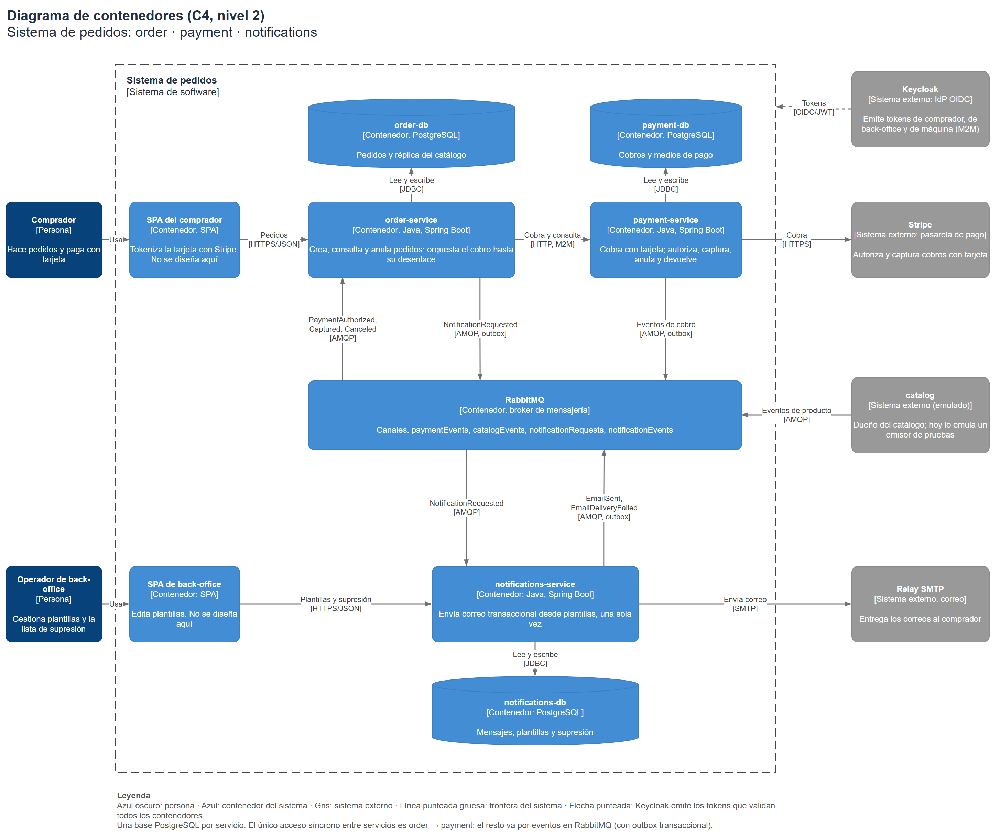

### 2.2 Qué hace cada microservicio

- **order — el pedido y su cobro.** Es la puerta de entrada del comprador. Registra el pedido
  congelando sku, nombre y precio, y **calcula él mismo el importe** a partir de su copia del catálogo
  (la solicitud solo trae producto y cantidad). Le pide a payment que cobre ese importe, sigue el
  desenlace del cobro por eventos y, cuando lo conoce, encarga el correo al comprador. Es el único que
  depende de los otros dos.
- **payment — cobrar sin saber qué se vende.** Es infraestructura de cobro: autoriza, captura, anula
  y devuelve importes con tarjeta que le piden otros servidores. Es el único que habla con Stripe, y
  publica el resultado de cada cobro para quien lo necesite. No sabe qué es un pedido.
- **notifications — enviar cada correo una sola vez.** Envía correo transaccional a partir de
  plantillas que negocio edita desde el back-office. Acepta la petición por HTTP o por evento,
  responde «aceptado» y envía después, con la garantía de no duplicar ningún mensaje.

Las tres piezas comparten la misma forma: una API propia, una base PostgreSQL propia, y eventos
publicados con *outbox* transaccional sobre RabbitMQ. La sección 5 detalla
cada servicio: su responsabilidad, sus datos, sus contratos y su comportamiento ante fallos.

## 3. Infraestructura

Los diseños (`specs/`) no nombran ninguna tecnología. La pila se eligió al generar cada servicio y
quedó en su `keel-stack.json`:

| Pieza | Elección | Para qué |
|---|---|---|
| Runtime | Spring Boot (`keel-spring`) | Los tres servicios |
| Base de datos | PostgreSQL | Una por servicio |
| Broker | RabbitMQ | Canales de eventos, con DLQ por suscripción |
| Identidad | Keycloak (OIDC) | Tokens de comprador, de back-office y de máquina (M2M) |
| Telemetría | OpenTelemetry, con un colector entre cada servicio y el backend | Trazas que cruzan HTTP y eventos, métricas y logs. Ver [Observabilidad](#7-observabilidad) |
| Pasarela de pago | **Stripe**, por su API REST (Payment Intents) con HTTP plano, sin SDK | Solo payment la usa; el diseño no la nombra y la trata como intercambiable. Ver [Integración con Stripe](#522-integración-con-stripe) |
| Correo | SMTP | Solo notifications; el proveedor es configuración de despliegue |

Cambiar RabbitMQ por Kafka, o Stripe por otra pasarela, no toca el diseño: se vuelve a generar con
otra pila.

## 4. Por qué esta arquitectura

Cada pieza de esta solución responde a una pregunta que alguien se haría con razón: ¿por qué tres
servicios y no uno?, ¿por qué un broker?, ¿por qué un servidor de identidad? Aquí van las respuestas.

### 4.1 Por qué tres microservicios

Porque cobrar, avisar y vender son tres cosas distintas, con riesgos distintos y que cambian por motivos
distintos.

- **payment cobra y nada más.** Aquí se juega el dinero: si se repite una llamada, se cobra dos veces.
  Concentrarlo en un solo servicio deja en un único sitio la clave de Stripe, el secreto de los avisos y
  toda la lógica de «autorizar, capturar, anular, devolver». Como no sabe qué es un pedido, mañana puede
  cobrar para otro servicio sin tocarse.
- **notifications envía correo y nada más.** Su riesgo es el contrario: mandar dos veces el mismo mensaje
  a una persona real. Tiene su propio ritmo de cambio (negocio edita las plantillas sin desplegar nada),
  sus propios datos personales con su propia política de purga y su propia lista de supresión.
- **order es el dueño del pedido.** Sabe qué compró el comprador y a qué precio, y coordina a los otros
  dos. Es el único que depende de ellos; ellos no saben que order existe.

Cada uno guarda **sus propios datos** y ninguno entra en la base del otro: se hablan por sus contratos,
no por sus tablas.

**Qué se gana.**

- *Los fallos no se contagian.* Si notifications se cae, el pedido avanza igual; si Stripe se cae, el
  comprador sigue recibiendo un pedido en un estado honesto (sección 9).
- *Cada riesgo vive en un solo lugar.* Un cambio en las plantillas no puede romper un cobro.
- *Los secretos quedan acotados.* Solo payment tiene la clave de Stripe.
- *Cada uno escala por su cuenta.* Los tres no soportan la misma carga ni por los mismos motivos: order
  sigue el ritmo de los compradores, payment el de los cobros (y de lo que tarde Stripe en contestar) y
  notifications el de los correos pendientes de enviar. Como cada servicio tiene su propia base de datos y
  se habla con los demás por contratos, se pueden añadir instancias de uno sin tocar a los otros. El diseño
  ya lo contempla: con varias instancias de order, cada una reclama un lote distinto en el barrido.

**Qué cuesta.** Más piezas que operar y una red en medio que puede fallar, perder una respuesta o
entregar un mensaje dos veces. Todo lo de la sección 8 (idempotencia, outbox, barridos) existe para pagar
ese precio. Un único servicio habría sido más simple de operar; se separó porque equivocarse al cobrar o
al enviar cuesta más que operar tres piezas.

### 4.2 Por qué un broker de mensajes

Porque no todo lo que ocurre entre los servicios es una pregunta con respuesta inmediata. Algunas cosas
son avisos de que *algo pasó*, y para eso un broker encaja mejor que una llamada HTTP.

- **El cobro no siempre termina cuando responde.** Un 3DS puede tardar horas, un aviso de Stripe puede
  llegar después y el barrido de payment puede resolverlo minutos más tarde. En vez de que order espere
  con una conexión abierta, payment publica el desenlace cuando lo conoce.
- **Sin broker, los servicios quedarían atados entre sí.** Para contarle a order que el cobro terminó,
  payment tendría que conocerlo y llamarlo, y entonces cada uno dependería del otro: order llama a payment
  y payment llama a order. Con el broker, payment publica `PaymentCaptured` sin saber quién lo escucha, y
  la dependencia va en un solo sentido: order depende de payment, nunca al revés. Lo mismo con
  `ProductUpserted`, que alimenta la réplica del catálogo. Y si mañana otro servicio necesita enterarse de
  un cobro, se suscribe al evento sin tocar a quien lo publica.
- **Si el destinatario está caído, el mensaje espera.** Con una llamada directa, notifications caído
  significaría un correo perdido o un pedido bloqueado. Con el broker, `NotificationRequested` queda en la
  cola hasta que vuelve (sección 9).
- **Entrega fiable.** Cada servicio escribe el evento en su *outbox*, en la misma transacción que el
  cambio de estado, y un relay lo publica después. Cada suscripción reintenta con espera creciente y, si
  un mensaje no hay manera, lo aparta a una cola de mensajes muertos para que no bloquee a los demás.

**No todo va por eventos.** Pedir el cobro (`POST /payments`) es una llamada directa, porque ahí quien
pide necesita una respuesta ahora. La regla es sencilla: *si necesito algo y espero la respuesta, HTTP; si
anuncio que algo ocurrió, evento.*

**Qué cuesta.** El broker entrega cada mensaje **al menos una vez**, así que puede llegar repetido. Por
eso los suscriptores se protegen contra duplicados (secciones 5.x.1 y 8).

### 4.3 Por qué RabbitMQ

Lo que el diseño le pide al broker es poco y concreto:

- **Una cola por suscripción**, cada una con sus reintentos con espera creciente y su cola de mensajes
  muertos.
- **Control de quién publica en cada canal**, porque `notificationRequests` solo debe aceptar a los
  servicios autorizados.
- **Mensajes de trabajo, no un historial.** Los eventos son avisos y encargos que se consumen y se
  olvidan: nadie necesita releer lo que ocurrió hace un mes.

RabbitMQ cubre las tres cosas de forma nativa y es una pieza mediana de operar. La alternativa que suele
ponerse al lado, Kafka, brilla cuando hay que **conservar y reprocesar** un flujo enorme de eventos, y
aquí no hace falta: ningún servicio relee el pasado.

**Es una decisión reversible.** El diseño habla de *canales*, no de colas ni de topics. Cambiar de broker
es volver a generar con otra pila, no rediseñar los servicios.

### 4.4 Por qué un servidor de autenticación

Porque en esta solución hay **tres tipos de identidad** y ninguno de los tres servicios debería ocuparse
de contraseñas.

- El **comprador** entra con OIDC; su `sub` es su identidad y su `email` sale del token, nunca del cuerpo.
- El **back-office** de notifications entra por rol.
- Los **servicios** se autentican entre sí con *client-credentials* y permisos mínimos (order solo puede
  pedir `payment:charge` y `payment:read`).

Un único emisor de tokens evita tener tres sistemas de login distintos y evita que cada servicio guarde
credenciales de usuarios. Cada servicio solo valida el token que recibe y decide qué deja hacer. Además,
quien emite no es quien usa: un servicio comprometido no puede darse permisos nuevos.

### 4.5 Por qué Keycloak

Por la misma razón de antes: lo que el diseño pide de la identidad es OIDC para personas, roles para el
back-office y *client-credentials* con permisos para las máquinas, y **Keycloak cubre las tres cosas en
una sola herramienta**. Se despliega uno mismo, así que no hay un tercero en el camino de cada petición ni
un coste por usuario, y el control de los tokens, los roles y los clientes máquina queda en casa.

El diseño dice `protocol: oidc`, nunca el producto, así que cambiar de servidor de identidad no toca los
diseños.

### 4.6 En una tabla

| Decisión | Qué resuelve | Qué cuesta | ¿Se cambia sin rediseñar? |
|---|---|---|---|
| Tres servicios | Cada riesgo (dinero, correo, pedido) vive en un solo sitio, los fallos no se contagian y cada uno escala por separado | Más piezas y una red que puede fallar | No: es la forma del diseño |
| Un broker | Avisos asíncronos, desacople y entrega fiable | Entrega «al menos una vez»: hay que deduplicar | Sí |
| RabbitMQ | Colas por suscripción, reintentos, mensajes muertos y control de quién publica | Operar una pieza más | Sí, se regenera con otro broker |
| Servidor de identidad | Un único emisor de tokens para personas, back-office y máquinas | Un servicio crítico más: si cae, nadie obtiene tokens nuevos | Sí |
| Keycloak | OIDC, roles y *client-credentials* en una sola herramienta que se autoaloja | Operarlo y mantenerlo | Sí, se regenera con otro IdP |

## 5. Cada servicio

### 5.1 order — el pedido y su cobro

Es la puerta de entrada del comprador: recibe sus pedidos, calcula cuánto hay que cobrar y se lo pide
a payment.

- **El importe lo calcula order, no viene en la solicitud.** El comprador solo indica qué quiere
  (`productId`) y cuántas unidades (`quantity`) por línea. order busca el precio de cada producto en su
  copia local del catálogo y obtiene el total como la suma de `precio × cantidad` de todas las líneas.
  Así nadie puede alterar el importe desde el navegador.
- **El pedido guarda lo que el comprador vio.** Cada línea **congela** el `sku`, el nombre y el precio
  del producto en el momento de crear el pedido, y no cambian después aunque el catálogo se actualice.
- **Después del cobro.** order le pide a payment que cobre ese importe, sigue el resultado por eventos y,
  cuando lo conoce, encarga a notifications el correo al comprador.
- **El catálogo no es suyo.** order mantiene una **réplica** local del catálogo, que se actualiza con los
  eventos `ProductUpserted` y `ProductRetired`. Mientras `catalog` no exista, esos eventos los publica un
  emisor de pruebas.

**Qué datos guarda.** order maneja tres entidades. El pedido (`Order`) y sus líneas (`OrderLine`) forman
un solo agregado: se crean juntos y no cambian por separado. `Product` es aparte: la réplica del
catálogo, que mantienen los eventos de catalog y que order solo lee para calcular el importe.

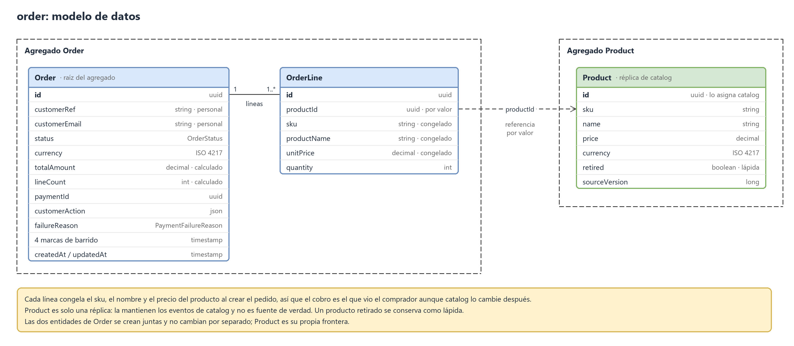

Dos detalles que explican el diagrama:

- **Las líneas guardan una copia, no una referencia.** `sku`, `productName` y `unitPrice` se congelan al
  crear el pedido. `productId` apunta a `Product` solo por valor, sin clave foránea: así el pedido no
  cambia aunque el catálogo sí.
- **No todos los campos de `Order` salen en la respuesta.** `customerRef` y `customerEmail` son datos
  personales y no aparecen en logs ni trazas; `totalAmount` y `lineCount` se calculan; y las cuatro
  marcas de barrido son internas, solo las usa el barrido de reconciliación.

Y este es el ciclo de vida del pedido:

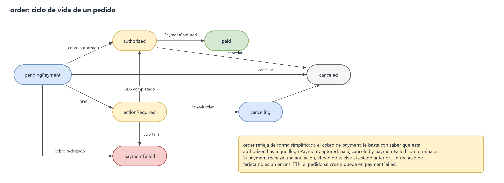

El ciclo de vida de `Order` es un **espejo simplificado** del de `Payment`: order no necesita saber que
un cobro está `capturing`; le basta con saber que está `authorized` hasta que llega `PaymentCaptured`.

#### 5.1.1 Idempotencia en order

order sabe que le van a repetir cosas: el comprador hace doble clic o reintenta tras un timeout, y
RabbitMQ puede entregar dos veces el mismo evento. Para que ninguna repetición cree un segundo pedido ni
cobre dos veces, cada punto de entrada tiene su propia guarda, y no es la misma en todos.

| Entrada | Guarda | Dura | Si se repite |
|---|---|---|---|
| `createOrder` | Cabecera **`Idempotency-Key` obligatoria**, una por comprador (la clave de un comprador no choca con la de otro) | 24 h | Mismo contenido: devuelve el pedido **en su estado actual**, no la respuesta original. Distinto contenido: `409 IDEMPOTENCY_KEY_REUSED`. Sin cabecera: `400 IDEMPOTENCY_KEY_REQUIRED` |
| `cancelOrder` | **Por estado**: la transición `actionRequired → canceling` no se puede repetir | Permanente | Si el pedido ya está en `canceling` o `canceled`, lo devuelve tal cual, sin volver a llamar a payment |
| Eventos de payment | **`metadata.eventId`** más el **estado de origen** de cada transición | Por evento | Se descarta, o no hace nada si el pedido ya no está en un estado desde el que ese evento pueda actuar |
| Consultas | No aplica | — | — |

**Por qué `createOrder` pide una clave y payment no.** El pedido todavía no existe cuando llega la
petición, y no hay ningún dato del comprador que lo identifique de forma única: dos pedidos iguales
pueden ser dos compras legítimas. Por eso es el comprador (la SPA) quien decide qué es «el mismo
intento» y lo declara con la clave. Solo así order distingue un doble clic de un segundo pedido.

**Qué devuelve una repetición.** El pedido tal como está ahora. Si el primer intento terminó con el
pedido en `pendingPayment` y el desenlace del cobro ya llegó, el comprador que reintenta ve `authorized`
o `paymentFailed`, no una foto antigua. Un rechazo de tarjeta tampoco es un error: repetir devuelve el
pedido en `paymentFailed`.

**Dos peticiones iguales a la vez.** La segunda recibe `409 IDEMPOTENCY_KEY_IN_PROGRESS` mientras la
primera se procesa. No crea nada: basta con reintentar, y el reintento devuelve el pedido ya creado.

**Los eventos se protegen dos veces.** Primero se descartan por `metadata.eventId`. Y aunque uno llegara
repetido, cada transición solo actúa desde sus estados de origen: un `PaymentCaptured` reentregado
sobre un pedido que ya está `paid` no hace nada, ni vuelve a pedir el correo.

**Hacia fuera, las claves salen del id del pedido.** Por eso repetir es seguro en cada salto:

| Hacia | Clave | Efecto de repetirla |
|---|---|---|
| payment | `chargeRequestId = order:<id>` | payment devuelve el mismo cobro, sin volver a llamar a Stripe. Es lo que permite reintentar la llamada automáticamente |
| notifications | `idempotencyKey = order:<id>:<desenlace>` (`paid`, `payment-failed`, `canceled`) | Un solo correo por desenlace, aunque el evento se entregue dos veces |

### 5.2 payment — cobrar sin saber qué se vende

Es la infraestructura de cobro: autoriza, captura, anula y devuelve importes con tarjeta que le piden
otros servidores, y admite 3DS.

- **No sabe qué se vende, ni qué es un pedido.** Recibe un **`chargeRequestId`**, una clave de negocio
  que pone quien pide el cobro, y un **`customerRef`** opaco. Para payment son solo dos identificadores.
- **Toda su API es servidor a servidor.** El navegador nunca lo llama: solo genera el token de tarjeta
  con el componente de Stripe.
- **Es el único que habla con Stripe.** Y publica el resultado de cada cobro para quien lo necesite.
- **Conoce el desenlace de un cobro por tres vías, y todas acaban en el mismo sitio.** La **respuesta
  síncrona** de la pasarela, el **aviso** (webhook) de la pasarela y un **barrido** cada 5 minutos que
  le pregunta a la pasarela por lo que lleva demasiado tiempo en vuelo.

**Qué datos guarda.** payment maneja dos agregados independientes. Uno es el cobro (`Payment`) con sus
devoluciones (`Refund`). El otro es el `Wallet` de cada titular, con sus medios de pago guardados
(`PaymentMethod`).

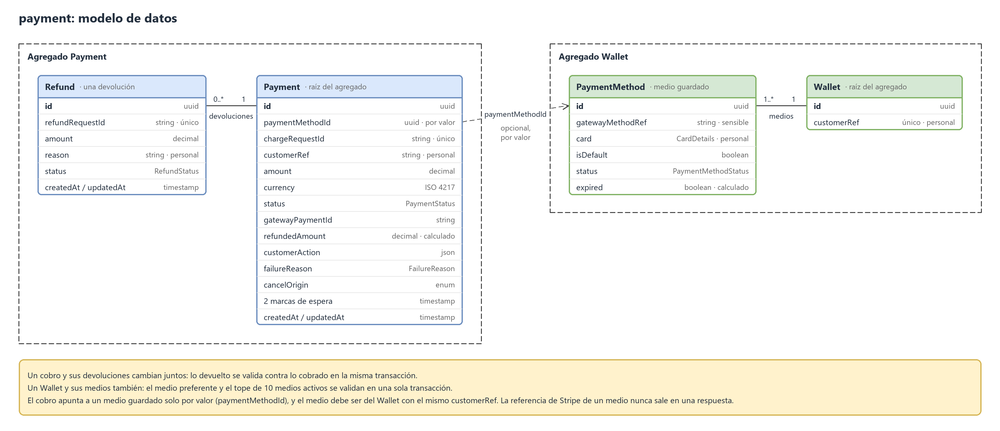

Cuatro detalles que explican el diagrama:

- **Un cobro y sus devoluciones cambian juntos.** Lo devuelto nunca puede superar lo cobrado, y eso se
  comprueba en la misma transacción en la que se registra la devolución.
- **Los medios guardados viven aparte.** Cada titular tiene un `Wallet` con hasta 10 medios activos y, como
  mucho, uno preferente. El `Wallet` nace con el primer medio que se guarda.
- **El cobro apunta al medio solo por valor.** `paymentMethodId` es opcional, y el medio tiene que ser del
  `Wallet` con el mismo `customerRef` que el cobro.
- **Las claves de negocio son únicas.** `chargeRequestId` y `refundRequestId` no se pueden repetir: son las
  guardas de idempotencia que se explican en la sección 5.2.1. Y de la tarjeta solo se guardan la marca,
  los últimos 4 dígitos y la caducidad; la referencia de Stripe del medio es sensible y nunca sale en una
  respuesta.

Y este es el ciclo de vida de un cobro:

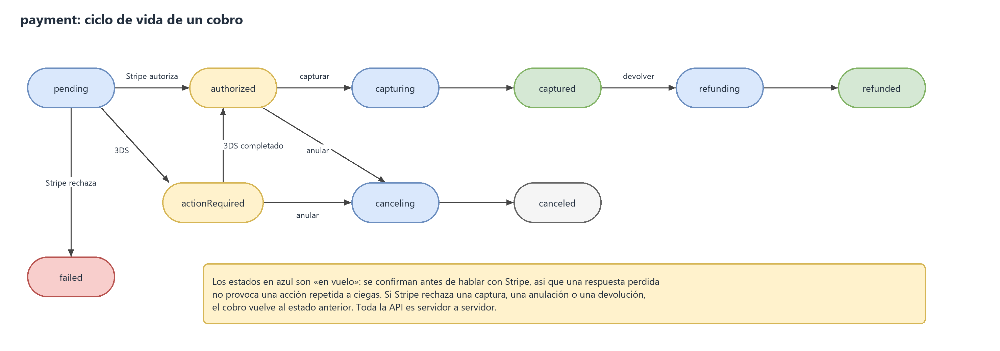

`pending`, `capturing`, `canceling` y `refunding` son **estados en vuelo**. El cobro se confirma en
ellos *antes* de hablar con Stripe. Si la respuesta se pierde, el sistema sabe que hay algo a medias y
no lo repite a ciegas; y dos acciones incompatibles (capturar y anular) no pueden llegar las dos a la
pasarela. Si Stripe rechaza una captura, una anulación o una devolución, el cobro vuelve al estado
anterior (`authorized` o `captured`).

#### 5.2.1 Idempotencia en payment

payment sabe que **su consumidor va a repetir peticiones**: tras un timeout, un reintento automático o
un doble clic. Por eso cada operación con efectos tiene una guarda propia, y la guarda no es siempre
la misma: depende de qué clave natural tiene la operación.

| Operación | Guarda | Dura | Si se repite |
|---|---|---|---|
| `requestCharge` | **Clave natural** `chargeRequestId` (en el cuerpo), con una restricción `UNIQUE` en la tabla `payments` | Permanente | Mismo contenido: `201` con el cobro tal como esté, sin volver a llamar a Stripe. Otro contenido: `409 CHARGE_REQUEST_CONFLICT` |
| `capturePayment` / `cancelPayment` | **Por estado**: la transición `authorized → capturing` (o `canceling`) no se puede repetir | Permanente | En `capturing`, `captured`, `refunding` o `refunded` (o `canceling`, `canceled`), `200` con el cobro tal cual |
| `refundPayment` | **Clave natural** `refundRequestId` de cada devolución (`Refund`) | Permanente | Mismo importe: el cobro tal cual. Otro importe: `409 REFUND_REQUEST_CONFLICT`. Una devolución `failed` no se reutiliza: se usa otra clave |
| `savePaymentMethod` | **Almacén de claves**: cabecera `Idempotency-Key` obligatoria, con firma SHA-256 del contenido | 24 h | Mismo cuerpo: el medio ya guardado. Otro cuerpo: `409 IDEMPOTENCY_KEY_REUSED`. Otra petición en curso: `409 IDEMPOTENCY_KEY_IN_PROGRESS` |
| `setDefaultPaymentMethod` / `removePaymentMethod` | **Natural**: fijan un valor, repetirlos no cambia nada | — | El mismo resultado (`200` / `204`) |
| Consultas | No aplica | — | — |

**Por qué `requestCharge` no usa una cabecera con caducidad.** `chargeRequestId` ya identifica al cobro
de forma única, así que la propia restricción `UNIQUE` es la guarda: no caduca y no se puede saltar. Una
cabecera con TTL habría añadido una segunda guarda que expira cuando la primera sigue vigente. Por eso
payment no pide `Idempotency-Key` en esta operación.

**Qué se compara al repetir.** Para decidir si «es la misma petición» se contrastan `customerRef`,
`amount`, `currency` y la fuente de pago: el `paymentMethodId` si es un medio guardado, y solo la
*clase* si es un token (el token no se guarda). Si algo difiere, es un conflicto, no una repetición.

**Dos peticiones iguales a la vez.** Las dos pasan la primera lectura y no encuentran nada; la segunda
en insertar choca con la restricción `UNIQUE`, relee a la ganadora y responde como una repetición. El
resultado es siempre un único cobro y una única llamada a la pasarela, y el consumidor **nunca recibe
un `409` por reintentar lo suyo**.

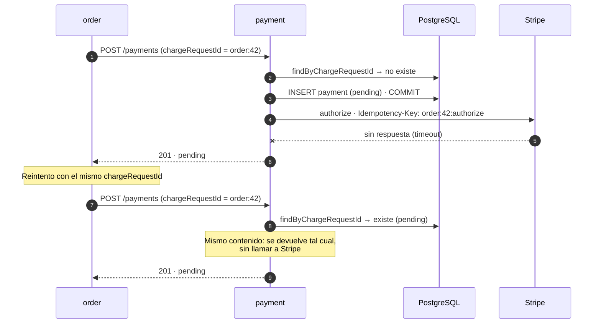

**Hacia Stripe también hay idempotencia.** Cada llamada a la pasarela lleva su propia
`Idempotency-Key`, construida como `<referencia>:<acción>` (por ejemplo `order:42:authorize`). Es la
misma en cada reintento y por las dos vías que pueden llevar un cobro hasta su desenlace (la petición y
el barrido), así que un cobro no se autoriza dos veces ni siquiera si payment pierde la respuesta de
Stripe.

**El almacén de claves de `savePaymentMethod`.** Es la única operación que lo usa, porque el token de
tarjeta es de un solo uso y no hay clave natural. La clave se registra en la **misma transacción** que
el medio guardado, de modo que no puede existir una clave sin recurso detrás. Un **error no consume la
clave**: tras un rechazo, un 3DS pendiente o una pasarela que no contestó, se puede reintentar con la
misma. Una fila caducada se trata como inexistente aunque la purga aún no haya pasado.

#### 5.2.2 Integración con Stripe

La pasarela de pago es **Stripe**, y payment es el único servicio que habla con ella. Se usa su
**API REST de Payment Intents**, llamada por HTTP directo (sin el SDK de Stripe) desde
`StripePaymentGateway`. La elección vive en `keel-stack.json` (`paymentGateway: stripe`) y no en el
diseño: los `specs/` no nombran a Stripe.

| Dato | Valor |
|---|---|
| URL base | `https://api.stripe.com` (variable `STRIPE_BASE_URL`, para apuntar a un emulador en pruebas) |
| Autenticación | Clave secreta de Stripe en `STRIPE_SECRET_KEY` |
| Avisos (webhook) | `POST /webhooks/payments`, firmados con `STRIPE_WEBHOOK_SECRET` |

Las credenciales llegan por variable de entorno y nunca se versionan.

**Qué llamada de Stripe hace cada operación de payment**

| Operación de payment | Llamada a Stripe |
|---|---|
| Pedir un cobro (`requestCharge`) | `POST /v1/payment_intents` con `capture_method=manual` y `confirm=true`: **autoriza sin capturar** |
| Capturar (`capturePayment`) | `POST /v1/payment_intents/{id}/capture` |
| Anular (`cancelPayment`) | `POST /v1/payment_intents/{id}/cancel` |
| Devolver (`refundPayment`) | `POST /v1/refunds` |
| Conocer el desenlace (barrido) | `GET /v1/payment_intents/{id}?expand[]=latest_charge`, o `GET /v1/payment_intents/search` si el cobro nunca recibió el id de Stripe |
| Guardar un medio (`savePaymentMethod`) | `POST /v1/customers` y `POST /v1/payment_methods/{pm}/attach`; si la respuesta no describe la tarjeta, `GET /v1/payment_methods/{pm}` |
| Retirar un medio (`removePaymentMethod`) | **Ninguna.** Solo se marca retirado en payment; Stripe lo sigue guardando, porque el diseño no tiene una acción de desvincularlo allí |

Autorizar y capturar son dos pasos separados a propósito: por eso existen los estados `authorized` y
`capturing` en el ciclo de vida de un cobro.

**El token de tarjeta.** El comprador escribe la tarjeta en el componente de Stripe del navegador, que
devuelve un `paymentToken` de un solo uso. Ese token recorre SPA → order → payment y payment lo entrega
a Stripe como `payment_method`. Ningún servicio nuestro lo guarda ni ve la tarjeta.

**Tres vías para conocer el desenlace.** Todas acaban aplicando el mismo resultado al cobro:
- la **respuesta síncrona** de Stripe a la llamada;
- el **aviso (webhook)**, que payment acepta solo si la cabecera `Stripe-Signature` es válida (firma
  HMAC con el secreto del webhook y una ventana de tolerancia de tiempo, en `StripeNoticeVerifier`);
- el **barrido** de payment, que cada 5 minutos consulta a Stripe por lo que lleva demasiado tiempo en
  vuelo.

**Idempotencia y fallos hacia Stripe.**
- Las llamadas sobre un cobro llevan la cabecera `Idempotency-Key` de Stripe, con la forma
  `<referencia>:<acción>` (por ejemplo `order:42:authorize`); las de guardar un medio, una clave propia
  derivada del token. Las consultas no llevan clave.
- Un `5xx` o un timeout **no se reintenta dentro de payment**: el cobro queda en un estado en vuelo y
  lo resuelve el barrido. Así nunca se manda a Stripe una segunda acción sin saber qué pasó con la
  primera.
- Si Stripe rechaza una devolución, el cobro sigue `captured`.

**Otros detalles de la integración.**
- La referencia del cobro viaja en la *metadata* de Stripe (`keel_reference`): es lo que permite
  encontrar un cobro cuyo id nunca se recibió.
- Los importes se convierten a la unidad menor de la moneda (centavos) sin redondear.
- Los rechazos de Stripe se traducen a un vocabulario neutro (`FailureReason`).
- Stripe queda detrás del puerto `PaymentGateway`. El dominio y los demás servicios no conocen sus
  tipos, así que cambiar de pasarela implica reescribir ese adaptador, no el diseño.

#### 5.2.3 Resiliencia al consumir payment (order → payment)

order es el único consumidor de payment. Llama a su API con **Resilience4j** sobre un cliente HTTP
declarado en el diseño (`specs/order/http-clients.keel.yaml`) y materializado en `PaymentHttpAdapter`.
Cada una de las cuatro llamadas (`requestCharge`, `capturePayment`, `cancelPayment`,
`getPaymentByChargeRequest`) tiene sus propias instancias de reintento y de circuit breaker, así que
una operación lenta no cierra el circuito de las demás.

| Pieza | Valor | Qué hace |
|---|---|---|
| **Timeout** | 5 s (conexión y lectura) | Acota cuánto espera order a payment |
| **Reintento** | 3 intentos en total, espera inicial de 300 ms, backoff exponencial ×2 | Absorbe un fallo pasajero |
| **Qué se reintenta** | `5xx`, timeout de lectura y fallo de conexión | Solo lo que puede ser transitorio |
| **Qué no** | Cualquier `4xx` | Es una respuesta de negocio o de validación: repetirla no la cambia |
| **Circuit breaker** | Se abre con un 50 % de fallos sobre las últimas 20 llamadas; queda abierto 30 s | Deja de golpear a un payment caído y protege a order de acumular hilos esperando |
| **Fallback** | `PaymentUnavailableException` → el caso de uso **degrada** | order no se cae: se queda en un estado intermedio honesto |
| **Credenciales** | OAuth2 *client-credentials*, scopes `payment:charge` y `payment:read` | Si falla el token, o payment responde `401`/`403`, se trata como «no disponible» |

**Por qué reintentar es seguro.** Es la pieza que une las dos mitades de esta sección: el reintento
automático solo es aceptable porque payment es idempotente.

- `requestCharge` repite el mismo `chargeRequestId`, y payment devuelve el mismo cobro.
- `capturePayment` y `cancelPayment` son idempotentes por estado: repetir una captura ya hecha
  devuelve el cobro, no un `409` que haga dudar a order de si se cobró.
- Las consultas no tienen efectos.

**Qué pasa cuando se agotan los reintentos o el circuito está abierto.** Cada llamada tiene un
fallback declarado en el diseño. No es un error para el comprador: la operación **degrada**.

| Llamada | Si payment no contesta | Quién lo recupera |
|---|---|---|
| `requestCharge` | El pedido queda en `pendingPayment` y la petición responde `201` con él | El barrido de order a los 30 min pregunta por `chargeRequestId` |
| `capturePayment` | El pedido sigue en `authorized` | El barrido vuelve a pedir la captura a los 10 min |
| `cancelPayment` | El pedido queda en `canceling` | El barrido vuelve a pedir la anulación a los 10 min |
| `getPaymentByChargeRequest` | El pedido sigue esperando | El siguiente ciclo del barrido |

**Un `4xx` no es una caída.** payment contestó, así que no cuenta como fallo del circuito ni se
reintenta: se traduce a `PaymentRejectedException` con el `code` del cuerpo. Tampoco lo es un rechazo
de tarjeta, que llega como un cobro en `failed`, no como un error HTTP.

**Cuando un timeout es ambiguo.** Tras un timeout, order no sabe si payment llegó a registrar el
cobro. No lo adivina: reintenta con la misma clave, o consulta `getPaymentByChargeRequest`. Si payment
responde `404 PAYMENT_NOT_FOUND`, el cobro nunca se registró y el pedido pasa a `paymentFailed
(notReceived)`.

La combinación forma tres capas: **reintento** para el fallo pasajero, **circuit breaker** para la
caída sostenida y **barrido de reconciliación** para lo que ninguna de las dos resuelve. Las tres
apoyadas en la idempotencia de payment.

### 5.3 notifications — enviar cada correo una sola vez

Es quien envía el correo transaccional: otros servicios le piden un correo y él lo compone, lo envía y
avisa del resultado, **una sola vez**.

- **Las plantillas las edita negocio.** Desde el back-office, sin desplegar nada.
- **Se le pide por dos puertas con el mismo contrato.** `POST /notifications` y el evento
  `NotificationRequested`.
- **Responde «aceptado» y envía después.** El `202` no promete la entrega: el mensaje queda `queued` y
  un barrido cada minuto lo envía.
- **Su mayor riesgo es mandar el mismo correo dos veces a una persona real.** Por eso la
  `idempotencyKey` es permanente, hay un único emisor (su guarda es la transición `queued → sending`,
  que se confirma antes de hablar con el relay) y el rescate de un mensaje atascado lo da por fallido y
  **no lo reenvía**.

**Qué datos guarda.** notifications maneja cuatro piezas. La plantilla (`EmailTemplate`) con sus versiones
(`EmailTemplateVersion`) forman un agregado. El mensaje (`EmailMessage`) es otro. Y la lista de supresión
(`SuppressedAddress`) y el remitente (`SenderSettings`) son cada uno el suyo.

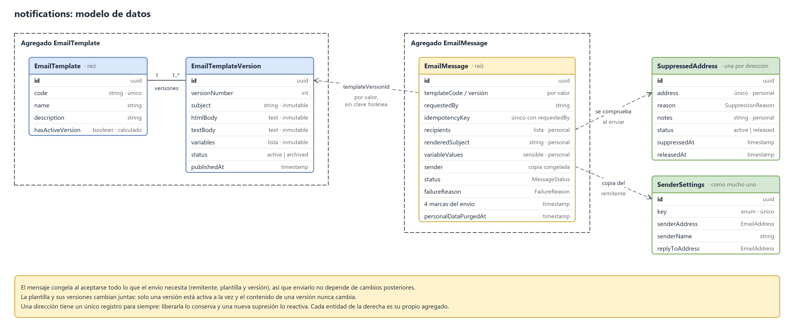

Cuatro detalles que explican el diagrama:

- **El contenido de una versión nunca cambia.** Solo cambia su estado, y solo una versión de cada plantilla
  está activa a la vez. Publicar una versión nueva no toca las anteriores.
- **El mensaje congela todo lo que necesita.** Al aceptarlo copia el remitente, el código de la plantilla
  y su versión, todo por valor. Por eso enviarlo no depende de cambios posteriores: se puede retirar una
  plantilla o cambiar el remitente sin afectar a un mensaje ya aceptado.
- **Los datos personales caducan.** `recipients`, `renderedSubject` y `variableValues` son personales. La
  purga a los 18 meses los vacía y marca `personalDataPurgedAt`, pero conserva la fila y su clave de
  idempotencia, para que una repetición tardía siga sin enviar nada.
- **Una dirección suprimida tiene un único registro, para siempre.** Liberarla lo conserva, y una nueva
  supresión lo reactiva. Se consulta al aceptar el mensaje y otra vez al enviarlo.

Y este es el flujo de un mensaje:

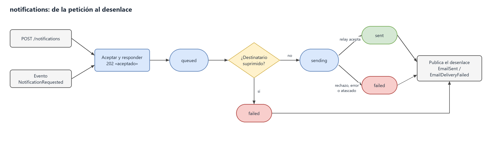

**Qué publica.** El desenlace en `notificationEvents` (`EmailSent`, `EmailDeliveryFailed`). order no los
escucha: el correo no cambia el estado de un pedido.

#### 5.3.1 Idempotencia en notifications

notifications sabe que le van a pedir el mismo correo más de una vez: el llamante reintenta tras un
timeout, y el evento `NotificationRequested` llega por un canal que puede entregar dos veces. Y sabe
que una repetición mal resuelta tiene un coste que no se deshace: **una persona real recibe dos
correos**. Por eso la idempotencia es permanente y el envío tiene un único emisor con su propia guarda.

| Entrada | Guarda | Dura | Si se repite |
|---|---|---|---|
| `requestNotification` (por HTTP y por evento) | **Clave natural** `(requestedBy, idempotencyKey)`; la clave viaja en el cuerpo | Permanente, también después de purgar los datos personales | Mismo contenido: devuelve el mensaje ya aceptado, sin crear otro. Distinto contenido: `409 IDEMPOTENCY_KEY_REUSED` |
| Envío (`sendQueuedMessage`) | **Por estado**: la transición `queued → sending` se confirma antes de hablar con el relay | Permanente | Si dos ejecuciones se solapan, solo una envía el mensaje |
| Rescate de un mensaje atascado | **No reenvía**: lo da por fallido (`stuck-in-sending`) | Permanente | El mensaje queda `failed`; no se reintenta solo |
| `suppressAddress` / `releaseAddress` | **Natural**: la dirección es la clave; fijan un valor, repetirlos no cambia nada | — | No hace nada (o reactiva una supresión liberada) |
| `publishTemplateVersion` | No tiene clave | — | Crea una versión idéntica, inocua y visible en el historial |
| Consultas | No aplica | — | — |

**Por qué la clave va en el cuerpo y no caduca.** La petición puede entrar por HTTP o por evento, y por
evento la entrega es *at least once*: la misma petición puede llegar dos veces sin que nadie haya
reintentado nada. Una cabecera con TTL no existe en un evento, y una clave que caduca permitiría que
una reentrega tardía enviara el correo otra vez. Por eso la clave es un campo de la petición y se
conserva incluso cuando la purga de privacidad (a los 18 meses) vacía los datos personales del mensaje.

**Por qué la clave es por llamante.** La unicidad es `(requestedBy, idempotencyKey)`, y `requestedBy`
lo fija el servidor a partir de la identidad del que pide, nunca el cuerpo. Así dos llamantes que usan
el mismo identificador (por ejemplo, ambos el id de un pedido) no chocan entre sí. order, por su parte,
compone la suya como `order:<id>:<desenlace>`.

**Qué se compara al repetir.** Para decidir si «es la misma petición» se contrastan el `templateCode`,
el conjunto de destinatarios (en minúsculas y sin duplicados) y el conjunto de pares nombre-valor de las
variables, sin importar el orden. Si el mensaje ya fue purgado, solo queda el `templateCode` para
comparar, y aun así **nunca se envía un segundo correo**. Una repetición devuelve el mensaje existente
aunque desde entonces la plantilla se haya retirado, el remitente haya cambiado o un destinatario se
haya suprimido: se resuelve antes de revisar nada de eso. Dos valores para la misma variable en una
misma petición se rechazan (`422 DUPLICATE_TEMPLATE_VARIABLES`) antes de comprobar la repetición.

**Dos peticiones iguales a la vez.** La segunda recibe `409 IDEMPOTENCY_KEY_IN_PROGRESS` mientras la
primera se acepta. No crea nada: basta con reintentar, y el reintento devuelve el mensaje ya aceptado.

**Enviar como mucho una vez.** El mensaje pasa a `sending` y eso se confirma *antes* de llamar al relay.
Si el proceso cae a mitad, el rescate lo cierra como `failed` y **no lo reenvía**: no se sabe si el
correo llegó a salir, y reenviarlo arriesga duplicarlo. Si el relay acepta después del rescate, el
mensaje se queda `failed`; ese desajuste está aceptado a propósito. Si el relay acepta a algún
destinatario, el mensaje queda `sent`, y los rechazados llegan como rebotes: marcarlo `failed`
invitaría a reintentar y duplicaría el correo a quien ya lo recibió.

**Recuperar un envío fallido.** Un `failed` no se reenvía solo: se vuelve a pedir con una clave nueva,
y eso es una decisión del llamante. Una petición que llega por evento y falla tres veces va a la cola de
mensajes muertos, y como la idempotencia hace segura la reinyección, se puede volver a publicar sin
riesgo de duplicar.

## 6. El flujo de una compra

Esta sección cuenta una compra de principio a fin, para ver cómo trabajan juntos los tres servicios. Hay
dos recorridos: el que sale bien y el del comprador que empieza a pagar con 3DS y lo abandona.

Los diagramas se leen de arriba abajo. Las flechas continuas son llamadas, las discontinuas son
respuestas y las de punta abierta son eventos que viajan por RabbitMQ.

### 6.1 Compra con pago aprobado

El comprador hace el pedido, order lo registra con el precio que vio y le pide a payment que cobre.
Stripe autoriza el importe, el comprador recibe su pedido ya autorizado y, por detrás, un evento hace que
order pida la captura. Cuando el dinero queda capturado, el pedido pasa a `paid` y notifications avisa al
comprador por correo.

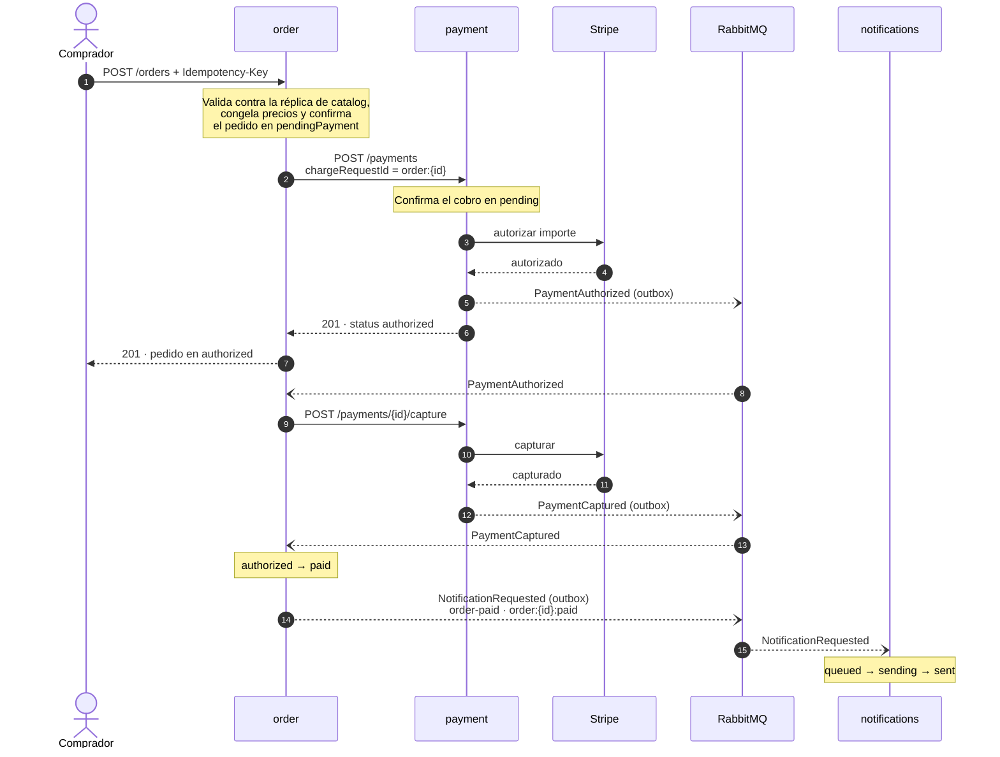

**Qué conviene fijarse.**

- **El pedido existe antes de cobrar.** order lo confirma en `pendingPayment` antes de llamar a payment, y
  la llamada nunca va dentro de la transacción. Si payment tarda o se cae, no hay filas retenidas y el
  pedido ya está en un estado honesto.
- **La captura la dispara el evento, no la respuesta.** payment publica `PaymentAuthorized` también
  cuando el desenlace es síncrono, así que solo hay un camino para capturar.
- **order vuelve a mirar el pedido tras cada respuesta de payment.** Si un evento se adelantó a la
  respuesta HTTP y ya movió el pedido, order responde con el estado actual, sin `409`.
- **Un rechazo de tarjeta no es un error.** `createOrder` responde `201` con el pedido en
  `paymentFailed`. Un error HTTP significa que la petición estaba mal, no que el banco dijo que no.

### 6.2 Con 3DS y el comprador que abandona

Con 3DS, el banco le pide al comprador un paso extra para confirmar el pago. Si lo completa, el pedido
sigue el camino de arriba. Si lo abandona, puede cancelar: order le pide a payment que anule la
autorización y, cuando payment lo confirma, el pedido pasa a `canceled` y se avisa por correo.

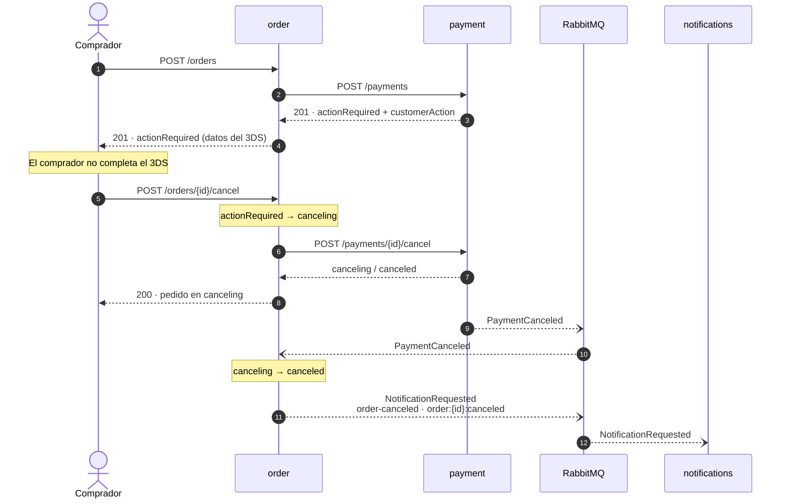

**Qué conviene fijarse.**

- **Cancelar pasa por un estado intermedio.** order confirma `canceling` antes de pedirle la anulación a
  payment, igual que con el cobro: si la respuesta se pierde, sabe que hay algo a medias y el barrido lo
  retoma.
- **Solo hay tres correos.** `order-paid`, `order-payment-failed` y `order-canceled`, cada uno con una
  `idempotencyKey` de la forma `order:<id>:<desenlace>`. Aunque un evento se entregue dos veces, el
  comprador recibe un único correo.

## 7. Observabilidad

Cuando un comprador dice «mi pedido se quedó a medias», hay que poder seguir *esa* compra de servicio en
servicio y ver dónde se torció. De eso va esta sección: qué cuenta cada servicio de sí mismo, por dónde lo
cuenta y cómo se junta todo en una sola historia.

La buena noticia es que los tres se generaron con la misma telemetría (`telemetry: otel` en su
`keel-stack.json`), así que **se observan igual**: mismas señales, mismo camino y mismas convenciones. Lo único
que cambia de uno a otro es lo que hacen y, por tanto, lo que se ve.

### 7.1 Tres señales, tres preguntas

Cada servicio cuenta lo que le pasa de tres formas, y cada una responde a una pregunta distinta:

- **Trazas: ¿por dónde pasó *esta* petición y dónde se fue el tiempo?** El servicio las **envía** al colector
  por OTLP/HTTP (`OTEL_EXPORTER_OTLP_ENDPOINT`), en lotes comprimidos.
- **Métricas: ¿cómo se está portando el servicio en conjunto?** El servicio las deja publicadas en
  `/actuator/prometheus` y **es el colector quien pasa a recogerlas** cada 15 s.
- **Logs: ¿qué decidió el código en ese momento?** Salen siempre por la consola (en JSON ECS fuera de `local`)
  para que los recoja la plataforma. Opcionalmente, también por OTLP (`LOG_EXPORT_OTLP`).

**Qué conviene fijarse.**

- **Las métricas se recogen, no se envían, y es a propósito.** Así viajan los *exemplars*, el enlace que lleva
  de un punto de una gráfica («el p95 subió») a una traza concreta que lo explica. Van en el formato de
  Prometheus, y el exportador OTLP de métricas de esta versión de Spring Boot no sabe emitirlos. Quien no pueda
  recogerlas puede enviarlas con `METRICS_EXPORT_OTLP=true`; solo pierde los exemplars.
- **Los logs nunca por los dos caminos a la vez**, o cada línea llegaría duplicada. En producción los recoge la
  plataforma desde la consola; el camino OTLP solo está encendido en el entorno de pruebas de cada servicio
  (`deploy/`), donde nadie mira la consola.
- **Tres hilos para tirar de una compra.** `trace.id` lleva a la traza. `correlationId` es el
  `X-Correlation-Id` que recibió el cliente y aparece en logs, spans y eventos. `keel.operation` es el nombre
  de la operación del diseño.

### 7.2 Un colector en medio

La idea que lo sostiene todo es sencilla: **el servicio no habla con ningún backend de observabilidad.** Solo
conoce la dirección de un *colector OpenTelemetry* y se lo entrega todo a él. A dónde va después (Tempo,
Jaeger, Prometheus, Loki, un SaaS…) se decide **solo en la configuración del colector**. Cambiar de backend es
editar su bloque `exporters` y reiniciarlo: la aplicación no se recompila, no se redespliega y ni se entera.

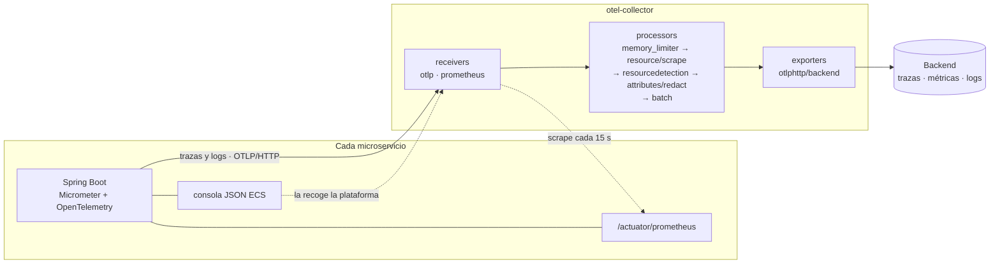

**Por qué merece la pena un colector en medio.**

- **El servicio no guarda credenciales de observabilidad.** Las del backend viven en el entorno del colector
  (`${env:…}`), nunca en el servicio ni en el repositorio.
- **Si el backend cae, el servicio ni lo nota.** Sigue respondiendo igual; quien acumula reintentos
  (`retry_on_failure`) y encola (`sending_queue`) es el colector, y los datos reaparecen cuando el backend
  vuelve.
- **Las reglas se ponen una vez para los tres.** Tapar credenciales, enriquecer los datos y, en producción,
  decidir qué trazas se guardan se aplica igual a los tres servicios, sin tocar su código.

Dentro del colector, los datos pasan por una cadena de procesadores (una por señal), y **el orden no es
casual**:

| Procesador | Qué hace | Por qué ahí |
|---|---|---|
| `memory_limiter` | Rechaza datos si el colector se queda sin memoria | **El primero**: si el backend se atasca, el colector dice «ahora no» en vez de caerse, y el servicio reintenta |
| `resource/scrape` | Pone `service.name` y `deployment.environment` a las métricas | Solo en métricas: lo que se recoge de `/actuator/prometheus` no trae esos datos, y sin ellos el panel no sabría de qué servicio es cada gráfica |
| `resourcedetection` | Completa los datos del entorno, sin pisar lo que ya trae la aplicación | Antes de enviar |
| `attributes/redact` | Borra las cabeceras `authorization`, `cookie`, `set-cookie` y `x-api-key` | La última red: ninguna credencial llega al backend aunque algo la capture por el camino |
| `batch` | Agrupa y comprime | **El último**: enviar dato a dato satura cualquier backend |

En el entorno de pruebas, el colector añade dos salidas de diagnóstico: `debug` (un resumen de cada lote en
sus logs) y `file/*` (lo que salió, tal cual, en `deploy/otel/out/`). Sirven para responder rápido a la
pregunta de siempre: si «no llega nada», ¿se rompe antes o después del colector?

### 7.3 Qué cuenta cada servicio

El mecanismo es el mismo en los tres; lo que cuentan sale del diseño de cada uno. Todos se identifican en
todas las señales por su `service.name` (`order`, `payment`, `notifications`) y traen su propio panel de
Grafana y sus alertas en `deploy/observability/`.

- **order cuenta la compra entera.** Un span por caso de uso (`keel.operation`), el consumo de los eventos de
  payment, la publicación desde el outbox y, sobre todo, **la llamada HTTP a payment**, con sus reintentos y el
  circuit breaker a la vista. También el barrido de reconciliación.
- **payment cuenta el cobro.** Un span por caso de uso, la publicación desde el outbox y cada llamada a
  Stripe, además del barrido contra la pasarela y los avisos que llegan de ella.
- **notifications cuenta el envío.** Un span por caso de uso, el consumo de `NotificationRequested` y un span
  **`keel.mail.send`** por cada entrega al relay SMTP, con el recorrido `queued → sending → sent`.

Las métricas son las mismas en los tres: `keel.use-case`, `keel.message.consume`, `keel.outbox.publish` y
`keel.timer.tick` (los barridos). notifications añade **`keel.mail.send`**, porque es el único con un
proveedor de correo detrás. Por eso su panel (`notifications — Keel`) tiene una fila «Correo» que los
paneles de `order — Keel` y `payment — Keel` no tienen. El resto de filas es común: casos de uso, HTTP,
outbox, mensajes consumidos, barridos y runtime (heap, GC, pool de conexiones). Cada panel solo enseña lo
que su diseño tiene.

**Las alertas ya vienen puestas** en los tres:

- **Eventos del outbox rendidos** (`keel.outbox.dead_lettered > 0`). Es pérdida de datos, así que tiene que
  ser siempre 0.
- **Tasa de error de los casos de uso** por encima del 5 %.
- **p95 de los casos de uso** por encima de 1 s.
- **Pool de conexiones saturado** y **presión de memoria** en el heap.

Sin datos no disparan: un servicio recién desplegado o sin tráfico no avisa de todo a la vez.

### 7.4 Una compra, una sola traza

Observar los tres servicios igual tiene un premio: poder seguir una compra de principio a fin como **una sola
historia**. La traza nace en order y viaja por dos caminos:

- **Por HTTP (order → payment).** El cliente HTTP de order añade la cabecera W3C `traceparent`, y payment
  continúa la misma traza. Al recibir, también se aceptan cabeceras B3.
- **Por eventos (payment → order → notifications).** El contexto de traza va dentro del sobre del evento
  (`metadata.traceparent`) y, con RabbitMQ, también en la cabecera nativa del broker. El relay del outbox
  publica **dentro de la traza original**, aunque lo haga más tarde, y quien consume engancha su span al del
  emisor. Para que el hilo no se corte, cada listener abre el contexto con la *metadata* del sobre
  (`CorrelationContext.runWith(envelope.metadata(), …)`) y no solo con el `correlationId`.

El resultado es que una compra con el pago aprobado (sección 6.1) se ve como **una sola traza** que cruza los
tres servicios, y que con el `X-Correlation-Id` que devolvió order se llega a sus logs en cada uno. Si
aparecen dos trazas separadas donde debería haber una, el eslabón roto suele ser un listener o un cliente HTTP
escrito a mano.

**Qué se deja fuera, para no ahogar lo importante.** Antes de enviar nada se descartan las peticiones a
`/actuator` y a las sondas, los ciclos de las tareas programadas y las consultas a la base que no cuelgan de
ningún trabajo. Sin ese filtro, el relay del outbox produciría una traza vacía en cada pasada.

### 7.5 Del entorno de pruebas a producción

El colector que hace falta depende de dónde se despliegue, no del servicio: el mismo jar sirve en Kubernetes,
en una VM o en ECS. Por eso cada servicio trae tres configuraciones en `deploy/otel/`:

- **`collector.yaml`: el de pruebas.** Un único colector junto a un Grafana LGTM (Tempo + Loki + Prometheus) en
  un contenedor. Recibe OTLP, recoge las métricas del servicio (`app:8080`) y lo envía todo a `lgtm`. Es el
  que se levanta con `deploy/up.sh`.
- **`collector-agent.example.yaml`: el agente de cada nodo** (un DaemonSet). Recoge la consola de los
  contenedores (`filelog`), añade los datos de Kubernetes y reparte las trazas **por `traceID`** entre los
  gateways. Es una plantilla: no se ha desplegado.
- **`collector-gateway.example.yaml`: el gateway central.** Es el único que conoce el backend, y decide qué
  trazas se guardan con *muestreo por cola* (`tail_sampling`). También es una plantilla.

**Por qué en producción son dos y no uno.** Para recoger la consola hay que estar *en cada nodo*; para decidir
si una traza merece guardarse hay que tenerla *entera delante*, con todos sus spans en el mismo colector. Las
dos cosas no caben en el mismo sitio, y de ahí el reparto por `traceID`.

**Qué trazas se guardan.** El muestreo por cola se queda con **todas las que tienen error, todas las que tardan
más de 1 s y un 10 % del resto**. Las interesantes son justo las raras, y muestrear a ciegas en el servicio
las perdería. Si se usa, hay que poner `TRACING_SAMPLING_PROBABILITY=1.0` en cada servicio; si no, se muestrea
dos veces (por defecto, el servicio guarda el 100 % en `develop` y el 10 % en `production`).

### 7.6 Lo que nunca sale, y dónde estamos hoy

- **Ni datos personales, ni secretos, ni cuerpos de petición.** Los campos `personal` (`customerRef`,
  `customerEmail`, destinatarios, asuntos renderizados…) y `sensitive` no aparecen en logs, trazas ni
  etiquetas de métricas: se identifica todo por id. Y, como última red, el colector borra las cabeceras con
  credenciales.
- **Las etiquetas de las métricas tienen pocos valores posibles** (operación, tipo de evento, desenlace). Los
  ids de negocio y el `correlationId` van como atributos del span, nunca como etiqueta: un id como etiqueta
  multiplicaría las series hasta hacer inmanejable el backend.
- **El `docker-compose.yaml` de la raíz no envía telemetría.** Levanta el sistema completo para validar el flujo
  con `TELEMETRY_EXPORT_ENABLED=false` y sin colector. El colector y Grafana viven en el `deploy/` de **cada
  servicio**, que prueba un servicio aislado, y no conviene tener los dos arriba a la vez porque publican los
  mismos puertos. Para ver la compra completa como una sola traza, habría que llevar el colector al compose del
  sistema o apuntar los tres servicios a uno común.
- **Las plantillas de producción (agente y gateway) no se han probado en un clúster.** Están validadas en su
  forma, no contra un destino real.

## 8. Patrones de fiabilidad (y por qué están)

Con tres servicios y una red en medio, las cosas se rompen de formas pequeñas: se pierde una respuesta,
un mensaje llega dos veces, un servicio tarda más de la cuenta. Estos ocho patrones son lo que evita que
el comprador se entere. Cada uno responde a una pregunta concreta.

- **¿Y si se confirma el cambio pero se pierde el aviso?** *Outbox transaccional*, en los tres servicios y
  en todo lo que publican. El evento se escribe en la misma transacción que el cambio de estado y un relay
  lo publica después. Así nunca se confirma una cosa sin la otra, aunque el broker esté caído.
- **¿Y si pedimos algo y no sabemos qué pasó?** *Estados en vuelo*: `pending`, `capturing`… en payment,
  `pendingPayment` y `canceling` en order, `sending` en notifications. El servicio deja constancia de que
  hay algo a medias *antes* de actuar, así no repite a ciegas una acción con efectos externos cuya
  respuesta se perdió.
- **¿Y si el comprador hace doble clic?** *Idempotencia en cadena*: la `Idempotency-Key` del comprador
  (24 h) da paso al `chargeRequestId` en payment (permanente) y a la `idempotencyKey` en notifications
  (permanente). Cada salto tiene su propia clave, y todas salen del id del pedido, así que ni un doble
  clic cobra dos veces ni se manda dos veces un correo.
- **¿Y si un evento llega repetido?** *Deduplicación de eventos* en las suscripciones de order. Se
  descarta por `metadata.eventId` y, además, cada transición solo actúa desde sus estados de origen: una
  reentrega no aplica dos veces el mismo desenlace.
- **¿Y si un mensaje falla?** *Reintentos y cola de mensajes muertos*, en cada suscripción: intentos con
  espera creciente de 1 s a 30 s (5 en order, 3 en notifications). Un fallo pasajero no pierde el evento y
  uno envenenado no bloquea la cola de los demás.
- **¿Y si payment va lento?** *Cliente HTTP resiliente* en la llamada de order a payment: 5 s de timeout,
  3 intentos con espera creciente y un circuit breaker que se abre con un 50 % de fallos sobre 20
  llamadas y queda abierto 30 s. Un payment lento no arrastra a order, y reintentar es seguro porque
  payment deduplica.
- **¿Y si algo se queda colgado para siempre?** *Barridos de reconciliación*: order y payment cada
  5 minutos, notifications cada minuto. Si se pierde un mensaje o una respuesta, el barrido lo recoge. Cada
  espera tiene su propia marca temporal.
- **¿Y si dos escrituras compiten?** *Bloqueo optimista* en todas las raíces de agregado. Un evento, el
  barrido y una anulación del comprador pueden coincidir sobre el mismo pedido: si dos escrituras compiten,
  una pierde con `409` y se reintenta, y ninguna pisa a la otra.

### 8.1 El barrido de order, la red de seguridad

Es la pieza que cierra todo el flujo: si algo falló por el camino, el barrido lo encuentra. Mira cuatro
esperas:

- **`pendingPayment` más de 30 min.** Pregunta a payment por el `chargeRequestId`. Si payment nunca lo
  registró, el pedido pasa a `paymentFailed(notReceived)`.
- **`authorized` sin captura confirmada más de 10 min.** Vuelve a pedir la captura.
- **`canceling` sin anulación confirmada más de 10 min.** Vuelve a pedir la anulación.
- **`actionRequired` más de 25 h.** Pregunta a payment. Son 25 y no 24 para dejar que payment, que anula
  el 3DS a las 24 h, publique antes su desenlace.

Procesa 100 pedidos por ciclo y, con varias instancias, cada una reclama un lote distinto.

## 9. Qué pasa cuando algo se cae

Ninguna pieza es infalible, así que el diseño decide de antemano qué ve el comprador y cómo se arregla
cada caída.

- **Si cae payment (o no responde en 5 s).** El comprador recibe `201` con su pedido en `pendingPayment`.
  Más tarde, el barrido de order pregunta por el cobro. Si payment nunca lo registró, el pedido pasa a
  `paymentFailed(notReceived)`.
- **Si cae Stripe.** El comprador ve lo que payment pueda decir: `pending` o `failed`. El barrido de
  payment consulta a la pasarela y publica el desenlace cuando lo conoce.
- **Si cae RabbitMQ.** El comprador no nota nada: las operaciones siguen respondiendo. Los eventos
  esperan en el outbox de cada servicio y salen cuando el broker vuelve.
- **Si cae notifications.** Tampoco se nota: el pedido avanza igual. `NotificationRequested` espera en la
  cola. Si notifications lo rechaza por una razón de negocio, va a su cola de mensajes muertos y order no
  se entera: es un riesgo aceptado en el diseño.
- **Si cae el relay SMTP.** El correo no llega. El mensaje acaba en `failed` y se publica
  `EmailDeliveryFailed`. **No se reenvía solo**, por diseño: es preferible no mandarlo a mandarlo dos
  veces.
- **Si catalog no está (hoy, siempre).** Se vende con la última copia conocida y la réplica se pone al día
  con el siguiente evento. Un producto que no está en la réplica responde `PRODUCT_NOT_AVAILABLE`.

La regla de fondo: **ante la duda, un estado intermedio honesto antes que un error**. Un timeout no
distingue «no llegó» de «se cobró», así que order no se inventa ninguna de las dos.

## 10. Seguridad y datos personales

Esta solución maneja dinero, tarjetas y correos de personas reales, así que la seguridad se decide por
una pregunta sencilla: *¿quién es quien pide esto y qué se le permite ver o hacer?* Estas son las
respuestas.

- **Hay tres tipos de identidad y un solo servidor que las emite.** El **comprador** entra con OIDC y es
  el `sub` de su token. El **back-office** de notifications entra por rol. Y los **servicios** se
  autentican entre sí con OAuth2 *client-credentials*: order solo puede pedir `payment:charge` y
  `payment:read`, nada más.
- **El email del comprador sale de su token, no de lo que escriba.** order lo toma del claim `email`, nunca
  del cuerpo de la petición, para que nadie pueda encargar correos a direcciones ajenas.
- **Cada comprador solo ve lo suyo.** Si pide un pedido que no es suyo, order responde `404` en lectura,
  para no revelar ni que existe, y `403 ORDER_NOT_OWNED` al intentar cancelarlo.
- **Quién puede pedir un correo lo controla el broker.** Publicar en `notificationRequests` lo decide la
  ACL del canal. La identidad del emisor viaja en `metadata.source` y debe coincidir con un cliente
  máquina que tenga el permiso `notification:send`.
- **La tarjeta nunca toca nuestros servidores.** El navegador la convierte en un token con el componente
  de Stripe, y payment solo guarda la marca, los últimos 4 dígitos y la caducidad.
- **Las credenciales de Stripe viven en un solo sitio.** La clave secreta (`STRIPE_SECRET_KEY`) y el
  secreto de los avisos (`STRIPE_WEBHOOK_SECRET`) solo las tiene payment, por variable de entorno, y nunca
  se suben al repositorio. El endpoint `POST /webhooks/payments` no pide token de usuario: lo protege la
  firma `Stripe-Signature`.
- **Los datos personales no salen donde no deben.** Los campos marcados `personal` (`customerRef`,
  `customerEmail`, destinatarios, asuntos renderizados…) nunca aparecen en logs ni trazas. Los
  `sensitive` (la referencia de Stripe de un medio guardado, las variables de un correo) tampoco salen en
  ninguna respuesta. notifications purga los datos personales a los 18 meses; order, de momento, los
  conserva sin plazo (sección 11).

### 10.1 Las tres credenciales del flujo de compra

En una compra viajan tres credenciales distintas y es fácil confundirlas. Cada una la emite un sistema
distinto y sirve para algo distinto.

| Credencial | La emite | Quién la presenta | Para qué |
|---|---|---|---|
| **Token de usuario** (JWT, OIDC) | Keycloak | El comprador, en `Authorization: Bearer` | Autenticarse ante `order` y fijar su `customerRef` (`sub`) |
| **`paymentToken`** (un solo uso) | Stripe | La SPA, en el cuerpo de `POST /orders` | Autorizar el cobro de su tarjeta; `order` lo reenvía a payment y no lo guarda |
| **Token M2M** (*client-credentials*) | Keycloak | `order`, al llamar a payment | Autenticar a `order` ante payment (`payment:charge`, `payment:read`) |

**Qué conviene fijarse.** El token de usuario no se reenvía a payment, y el `paymentToken` no pasa por
Keycloak. Cada credencial llega solo hasta donde le toca.

## 11. Limitaciones conocidas y siguientes pasos

- **catalog está emulado.** El contrato de `ProductUpserted` y `ProductRetired` es una **propuesta** de
  order. Cuando exista el catalog real, su `INTEGRATION.md` sustituye a la propuesta, y hay que
  revisar el riesgo aceptado de reentregas en la réplica.
- **order no devuelve dinero.** payment ya sabe hacer devoluciones (`refundPayment`, `PaymentRefunded`),
  pero en order `paid` es terminal. Es el punto de extensión más natural.
- **order no tiene política de retención** de datos personales. Será una evolución minor cuando se fije
  la política legal.
- **Sin superficie M2M en order.** Hoy nadie la consume. Si aparece un consumidor, tendrá operaciones
  propias.

Cualquier cambio de los anteriores entra por el diseño (`/keel-evolve specs/<servicio>`) y llega al
código con `keel-spring build --refresh --prune`. Nunca se toca primero `services/`.

## 12. Para profundizar

| Servicio | Diseño | Contrato servidor a servidor | Contratos formales |
|---|---|---|---|
| order | [DESIGN.md](docs/order/DESIGN.md) | — (no tiene consumidores) | — |
| payment | [DESIGN.md](docs/payment/DESIGN.md) | [INTEGRATION.md](docs/payment/INTEGRATION.md) | [openapi](docs/payment/openapi.yaml) · [asyncapi](docs/payment/asyncapi.yaml) |
| notifications | [DESIGN.md](docs/notifications/DESIGN.md) | [INTEGRATION.md](docs/notifications/INTEGRATION.md) | [openapi](docs/notifications/openapi.yaml) · [asyncapi](docs/notifications/asyncapi.yaml) |
