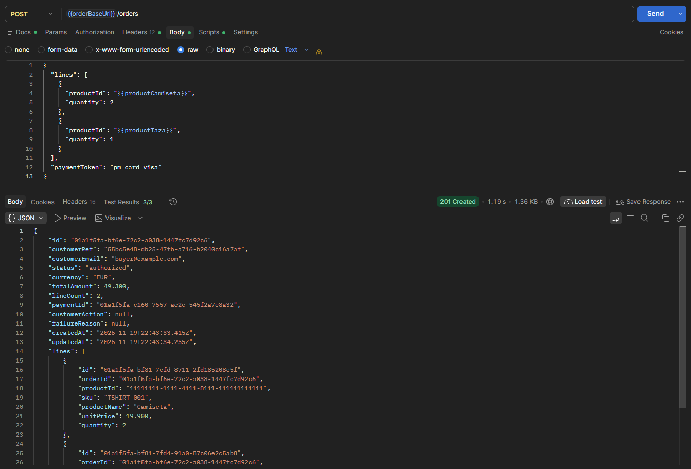
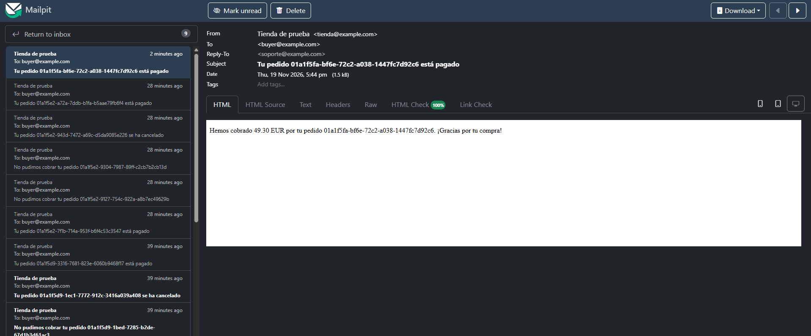

# Sistema de pedidos: order · payment · notifications

Un comprador hace un pedido desde una SPA y la solución lo gestiona de principio a fin: **order** registra
el pedido y calcula el importe, **payment** lo cobra con tarjeta a través de Stripe y **notifications**
avisa al comprador por correo. Los servicios se comunican por HTTP y por eventos (RabbitMQ), se autentican
con Keycloak y cada uno guarda sus datos en su propia base PostgreSQL.

El repositorio contiene el **diseño** de cada servicio (artefactos declarativos agnósticos de tecnología) y el
**código** que se generó a partir de él con Spring Boot.

> **Herramienta utilizada: [Keel](https://github.com/keel-system/keel), de mi autoría.** Los tres servicios se
> diseñaron y generaron con Keel. Cada servicio se describe primero como un diseño agnóstico de tecnología, capa
> por capa (`specs/<servicio>/`); después, un generador (aquí `keel-spring`) produce el proyecto Spring Boot en
> `services/<servicio>-spring/`, que se completa y se valida contra los escenarios del propio diseño. La
> metodología está en [`docs/methodology.md`](docs/methodology.md).

## Dónde está cada microservicio

| Microservicio | Qué hace | Diseño | Código |
|---|---|---|---|
| **order** | Recibe los pedidos, calcula el importe con su copia del catálogo y coordina el cobro y el aviso | [`specs/order`](specs/order/) · [DESIGN.md](docs/order/DESIGN.md) | [`services/order-spring`](services/order-spring/) |
| **payment** | Cobra con tarjeta: autoriza, captura, anula y devuelve, y guarda medios de pago | [`specs/payment`](specs/payment/) · [DESIGN.md](docs/payment/DESIGN.md) | [`services/payment-spring`](services/payment-spring/) |
| **notifications** | Envía correo transaccional desde plantillas, una sola vez por mensaje | [`specs/notifications`](specs/notifications/) · [DESIGN.md](docs/notifications/DESIGN.md) | [`services/notifications-spring`](services/notifications-spring/) |

Para entender cómo encajan, por qué están hechos así y qué pasa cuando algo falla, lee
[ARCHITECTURE.md](ARCHITECTURE.md). Los diagramas están en [`docs/diagrams`](docs/diagrams/).

> **Para levantar un servicio** hay que generar antes su configuración local con `keel-spring build`:
> `deploy/.env` e `infra/test-credentials.env` no se versionan porque llevan credenciales de prueba.

## Probar el flujo completo

El [`docker-compose.yaml`](docker-compose.yaml) de la raíz levanta los tres servicios sobre una
infraestructura compartida (PostgreSQL, RabbitMQ, Keycloak y Mailpit) y los deja listos para que **solo
tengas que hacer peticiones a order**: un pedido se cobra en payment y el correo aparece en Mailpit.

Stripe va **simulado** con WireMock ([`compose/stripe-mock`](compose/stripe-mock/mappings/)), así que no
hace falta cuenta ni clave: el resultado del cobro lo decide la tarjeta de prueba que mandes, igual que en
Stripe real. Si tienes una clave `sk_test_…`, puedes usar Stripe real poniéndola en un `.env` (ver
[`.env.example`](.env.example)).

1. Clona el repositorio y entra en su carpeta:

   ```bash
   git clone https://github.com/asuridev/prueba-gelsa.git
   cd prueba-gelsa
   ```

   Necesitas Docker o Podman (con `podman-compose`) y una terminal bash. **En Windows, usa Git Bash**, no `cmd`
   ni PowerShell: allí el comando `bash` es el de WSL y no encuentra compose. Desde `cmd` también puedes
   lanzarlo con `"C:\Program Files\Git\bin\bash.exe" up.sh`.
2. (Opcional) Copia `.env.example` como `.env` si quieres cambiar puertos o usar Stripe real.
3. `bash up.sh`: construye las imágenes, arranca el sistema y espera a que termine la siembra.
4. Lanza las peticiones con la colección de Postman (empieza por «0. Autenticación»):
   - **Import**: el archivo [`postman/order-flujo.postman_collection.json`](postman/order-flujo.postman_collection.json)
     (formato clásico v2.1; el botón Import no acepta la carpeta v3).
   - **Local Files → Open Folder** con la raíz del repo: Postman lee la versión v3 de
     [`postman/collections/`](postman/collections/).
   - **Terminal**: `postman collection run "postman/collections/Sistema de pedidos - flujo desde order"`.

   Las mismas peticiones están en [`compose/requests.http`](compose/requests.http) para VS Code. Qué enviar
   en cada paso, qué debe responder y qué pasa por detrás: [`docs/pruebas-manuales.md`](docs/pruebas-manuales.md).

   Un pedido pagado con `pm_card_visa`: order responde `201` en `authorized`, calcula él mismo el importe
   (49.30 EUR) y congela sku, nombre y precio en cada línea.

   

5. **Valida las notificaciones en Mailpit: http://localhost:8025.** Es el buzón donde llega cada correo que
   envía notifications al comprador (`buyer@example.com`): uno por desenlace del pedido (pagado, pago fallido
   o cancelado), como mucho un minuto después de que el pedido cambie de estado.

   

6. `bash down.sh` para apagarlo (`bash down.sh -v` borra también la base y vuelve a sembrar al subir).

La siembra ([`compose/seed/seed.sh`](compose/seed/seed.sh)) crea el comprador `buyer`, el cliente M2M con el
que order llama a payment, el remitente y las tres plantillas de correo, y emula tres productos del catálogo.

Dos ajustes son **parches de despliegue**, no del diseño:

- notifications escucha en un canal genérico (`any-registered-system.events`) y order publica en el suyo
  (`order.events`). La siembra los une con un binding entre exchanges.
- notifications solo acepta eventos de emisores registrados, y order no estaba en la lista. Se añade por
  configuración.

El arreglo de verdad es declarar a order como emisor en el diseño de notifications (`/keel-evolve
specs/notifications`). Los avisos (webhooks) de Stripe no llegan a localhost: payment conoce el desenlace por
la respuesta síncrona y por su barrido.

### Mirar por dentro: bases de datos y eventos

Además de las respuestas de order y los correos de Mailpit, puedes ver qué guarda cada servicio y qué eventos
viajan entre ellos.

#### Las tablas de cada servicio, con un cliente de base de datos

Usa el cliente que prefieras (DBeaver, pgAdmin, DataGrip, la extensión de PostgreSQL de VS Code o `psql`) y
crea **una conexión por servicio**. Los tres comparten servidor, pero cada uno tiene su propia base y su propio
usuario, y ninguno ve las tablas de los otros:

| Servicio | Host | Puerto | Base | Usuario | Contraseña |
|---|---|---|---|---|---|
| order | `localhost` | `5432` | `order` | `order` | `changeme` |
| payment | `localhost` | `5432` | `payment` | `payment` | `changeme` |
| notifications | `localhost` | `5432` | `notifications` | `notifications` | `changeme` |

Si ya tienes un PostgreSQL propio en el 5432, el contenedor no podrá arrancar: cambia `DB_PORT` en `.env` y
usa ese puerto en la conexión.

Qué mirar en cada una después de hacer un pedido:

- **order: `orders` y `order_lines`.** El pedido con su `status`, el `total_amount` que calculó order y el
  `payment_id` del cobro. En `order_lines`, el `sku`, el `product_name` y el `unit_price` congelados.
  `products` es la réplica del catálogo, con los tres productos sembrados.
- **payment: `payments`.** El cobro, con su `charge_request_id` (`order:<id del pedido>`), el `status`
  (`AUTHORIZED`, `CAPTURED`, `FAILED`…) y el `gateway_payment_id` que devolvió Stripe.
- **notifications: `email_messages`.** Cada correo, con su `template_code`, su `status` (`QUEUED` → `SENT`) y la
  `idempotency_key` que impide enviarlo dos veces.
- **En los tres: `outbox_event`.** Los eventos que el servicio escribió en la misma transacción que el cambio de
  estado; `published_at` dice cuándo los publicó en RabbitMQ.

Por ejemplo, para seguir un pedido de order a payment:

```sql
-- En la base order
select id, status, total_amount, failure_reason, payment_id from orders order by created_at desc;

-- En la base payment: el cobro de ese pedido
select charge_request_id, status, amount, currency, gateway_payment_id from payments order by created_at desc;
```

En la base, los estados se guardan en mayúsculas (`PAID`); la API los devuelve en minúsculas (`paid`).

#### Los eventos, en la consola de RabbitMQ

Abre http://localhost:15672 y entra con **`guest` / `guest`**.

- **Pestaña *Exchanges*: por dónde publica cada servicio.** `order.events`, `payment.events`,
  `notifications.events` y `catalog.events` (el catálogo emulado). Al abrir uno, la gráfica *Message rates*
  muestra los eventos que pasan y la lista de *Bindings* dice a qué colas llegan.
- **Pestaña *Queues*: quién los consume.** `order.payment` (order escuchando a payment), `order.catalog` (order
  escuchando al catálogo) y `notifications.any-registered-system` (notifications escuchando a order). Suelen
  estar a 0 porque se consumen al momento. Sus `-dlq` deben estar **siempre a 0**: un mensaje ahí es un evento
  rechazado que no se aplicó.

**Para leer el contenido de los eventos**, usa las colas `paymentEvents`, `notificationRequests` y
`notificationEvents`. Nadie las consume, así que guardan una copia de cada evento:

1. En *Queues*, abre `paymentEvents` (o la que te interese).
2. Despliega **Get messages**, elige *Ack mode*: **Nack message requeue true** (así el mensaje no se borra) y
   pulsa **Get Message(s)**.
3. Verás el *routing key* (por ejemplo `payment.payment-authorized`) y el sobre del evento: `metadata` (`eventId`,
   `eventType`, `source`, `correlationId`, `traceparent`) y `data`, con el contenido.

   Así se ve un `EmailSent` leído desde `notificationEvents`: el exchange por el que salió
   (`notifications.events`), su *routing key*, el tipo de evento, la cabecera `traceparent` que permite seguirlo en
   la traza y, en *Payload*, el sobre con la `metadata` y los datos.

   

| Cola | Qué eventos copia |
|---|---|
| `paymentEvents` | Los de payment: `PaymentAuthorized`, `PaymentCaptured`, `PaymentFailed`, `PaymentCanceled`… |
| `notificationRequests` | Los encargos de correo de order (`NotificationRequested`) |
| `notificationEvents` | Los desenlaces de notifications: `EmailSent` y `EmailDeliveryFailed` |

Estas tres colas crecen sin parar mientras el sistema está arriba. Para vaciarlas, en cada una usa **Purge
messages**, o apaga con `bash down.sh -v`.

> Edita libremente esta introducción para describir tu organización, convenciones o cómo contribuir.
> La tabla de la sección **Servicios diseñados** la genera `keel index` (lo ejecutan `/keel-design` al
> cerrar un diseño, `/keel-handoff` y `/keel-docs`); **no edites a mano el contenido entre los
> marcadores**, se pisa en la siguiente ejecución. `keel index --check` comprueba, sin escribir, que el
> índice sigue al día.

## Servicios diseñados

Cada servicio enlaza, si existen: su **documento de diseño** (`DESIGN.md`: modelo de dominio, invariantes,
decisiones y cómo reutilizarlo), el **panel de revisión** (`overview.html`, de `/keel-docs`: el servicio
entero de un vistazo, con enlaces a los contratos y a las colecciones Postman), los visores de sus
**contratos formales** —**API** (`openapi.html`) y **eventos** (`asyncapi.html`)— y su **contrato
servidor-a-servidor** (`INTEGRATION.md`, de `/keel-integrate`).

> Los tres enlaces HTML solo se abren renderizados en GitHub si el workspace declara dónde está publicado.
> Crea un `publish.yaml` en esta raíz con `repo: <org>/<repo>` (y `branch:` si no es `main`) y vuelve a
> ejecutar `keel index`: sin él quedan como enlaces relativos, que GitHub muestra como código fuente.

<!-- keel:servicios:start -->
| Diseño | Dominio | Madurez | Resumen | Capas | Documentación |
|---|---|---|---|---|---|
| [`notifications`](specs/notifications/) | — | — | Envía correo transaccional a partir de plantillas que gestiona negocio, a petición de los sistemas de la organización por HTTP o por eventos, sin enviar nunca dos veces el mismo correo. | `domain`, `use-cases`, `api`, `security`, `messaging`, `persistence`, `mail` | [diseño](docs/notifications/DESIGN.md) · [panel](https://htmlpreview.github.io/?https://raw.githubusercontent.com/asuridev/prueba-gelsa/main/docs/notifications/overview.html) · [API](https://htmlpreview.github.io/?https://raw.githubusercontent.com/asuridev/prueba-gelsa/main/docs/notifications/openapi.html) · [eventos](https://htmlpreview.github.io/?https://raw.githubusercontent.com/asuridev/prueba-gelsa/main/docs/notifications/asyncapi.html) · [integración](docs/notifications/INTEGRATION.md) |
| [`order`](specs/order/) | commerce | — | Recibe los pedidos de los compradores, calcula su importe con la copia local del catálogo, pide el cobro a payment, sigue su desenlace y lo notifica al comprador a través de notifications. | `domain`, `use-cases`, `api`, `security`, `messaging`, `http-clients`, `dependencies`, `persistence` | [diseño](docs/order/DESIGN.md) |
| [`payment`](specs/payment/) | commerce | — | Cobra con tarjeta, a través de una pasarela intercambiable, los importes que le piden otros servidores — autorizar, capturar, anular y devolver —, y guarda medios de pago para cobrar sin el cliente presente. | `domain`, `use-cases`, `api`, `security`, `messaging`, `persistence`, `payments` | [diseño](docs/payment/DESIGN.md) · [panel](https://htmlpreview.github.io/?https://raw.githubusercontent.com/asuridev/prueba-gelsa/main/docs/payment/overview.html) · [API](https://htmlpreview.github.io/?https://raw.githubusercontent.com/asuridev/prueba-gelsa/main/docs/payment/openapi.html) · [eventos](https://htmlpreview.github.io/?https://raw.githubusercontent.com/asuridev/prueba-gelsa/main/docs/payment/asyncapi.html) · [integración](docs/payment/INTEGRATION.md) |
<!-- keel:servicios:end -->

composition.md`.
